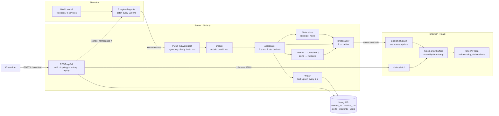
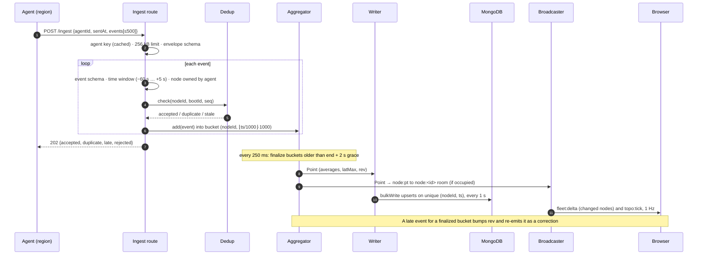
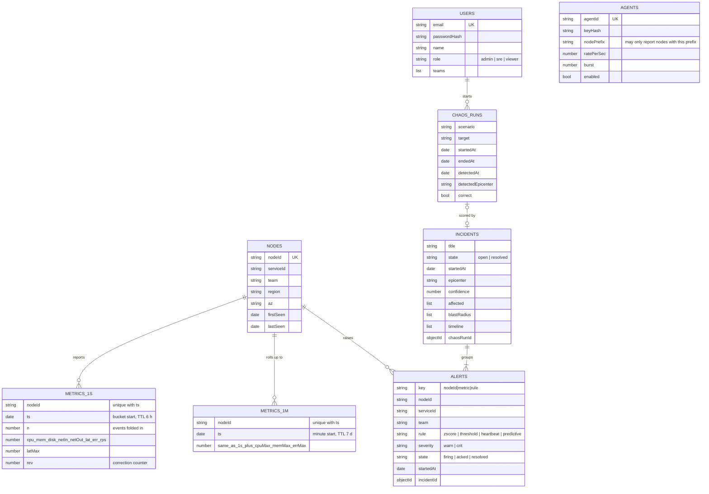
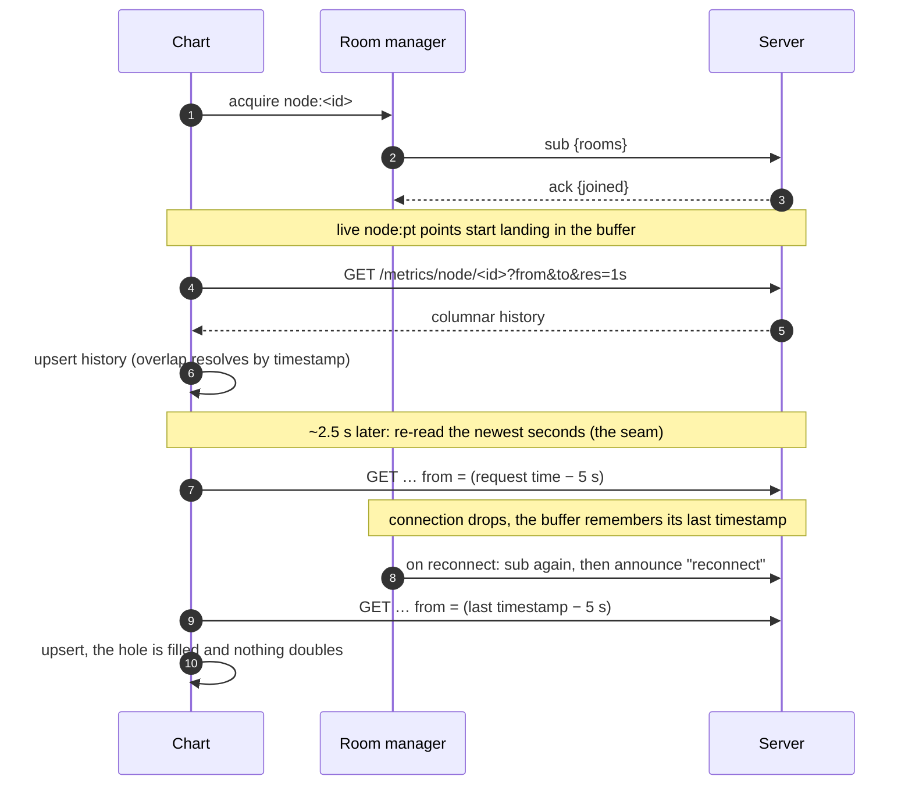

# Epicenter architecture

This document explains how Epicenter ingests, processes, stores and broadcasts telemetry, and how the browser
merges history with the live stream. Diagrams are Mermaid and render on GitHub.

> **Status.** Parts marked † are designed and wired into the web app but still being implemented on the
> server: anomaly detection and alerts, the incident correlator, chaos commands over `/control`, ingest load
> shedding and the per-agent token bucket. <!-- Remove this note and the † marks once A7–A10 are merged. -->

1. [System overview](#1-system-overview)
2. [The path of one event](#2-the-path-of-one-event)
3. [Data model](#3-data-model)
4. [Real-time communication](#4-real-time-communication)
5. [History and live without duplicates](#5-history-and-live-without-duplicates)
6. [Incident replay](#6-incident-replay)
7. [Performance techniques](#7-performance-techniques)
8. [Security and access control](#8-security-and-access-control)
9. [Testing](#9-testing)

---

## 1. System overview

**One contract, three consumers.** The `shared` package defines the topology, the zod schemas, the socket
event names, the positional payload layouts and every limit. The simulator, the server and the client import
it, so a change to a payload shape is a compile error everywhere it matters, not a runtime surprise.

| Part | Responsibility | Where |
|---|---|---|
| Simulator | Load model and per-region ingest agents | `simulator/src` |
| Ingest pipeline | Validate, dedup, aggregate, track state; no database on the hot path | `server/src/pipeline` |
| Writer | Idempotent batched persistence of rollups | `server/src/pipeline/writer.ts` |
| History API | Columnar node, service and replay series | `server/src/http/routes/history.ts` |
| Realtime | `/dash` namespace, room access, broadcaster | `server/src/realtime` |
| Client data layer | Buffers, subscriptions, history merge, clock, replay | `client/src/data` |
| Client views | Pages and canvas components | `client/src/pages`, `client/src/components` |

## 2. The path of one event

**Why aggregate before storing?** At two to five events per node per second, storing raw events would multiply
writes for no visual gain. One-second rollups are what every chart draws, and they give each data point a
natural identity, `(nodeId, ts)`.

**Why a grace period?** Agents batch, networks reorder, and retries arrive late. Holding each second open for
2 s lets nearly all of its events land before it is finalized. Anything later still counts: it corrects the
stored point and increments `rev`. The price is that live charts run about 3 s behind the wall clock; the
Pipeline page shows that delay explicitly.

## 3. Data model

| Collection | Key indexes | Notes |
|---|---|---|
| `metrics_1s` | **unique `{nodeId, ts}`**; TTL on `ts` (6 h) | about 48 documents a second; roughly 1 M in the window |
| `metrics_1m` | unique `{nodeId, ts}`; TTL on `ts` (7 d) | long-range history (ranges over 30 min) |
| `nodes` | unique `nodeId`; `serviceId` | node index on the wire is assigned in memory, persisted in the background |
| `alerts` | `{state, startedAt}`; `key`; `incidentId` | persisted on state changes only |
| `incidents` | `{state, startedAt}` | timeline embedded |
| `users`, `agents` | unique `email`, unique `agentId` | agent keys stored as hashes |

**A regular collection with a unique compound index, not a time-series collection.** Time-series collections
compress better but cannot enforce uniqueness. The unique `(nodeId, ts)` index makes a duplicate point
impossible at the storage layer and lets a late event correct a bucket with a plain upsert. For a system whose
core promise is "no duplicates", that is the right trade.

## 4. Real-time communication

### Namespaces

| Namespace | Who | Auth |
|---|---|---|
| `/dash` | browsers | JWT in `handshake.auth.token`, verified once per connection |
| `/control` † | simulators | simulator key; the server pushes chaos commands |

The default namespace refuses all connections.

### Rooms and payloads

| Room | Event | Payload (positional) | Rate |
|---|---|---|---|
| `fleet:<team>` | `fleet:delta` | `[tsSec, [nodeIdx, cpu, mem, status], …]`, changed nodes only | 1 Hz |
| `topology` | `topo:tick` | `[tsSec, [svcIdx, cpuAvg, latP95, errAvg, rps, healthy, total, status], …]` | 1 Hz |
| `node:<id>` | `node:pt` | `[nodeIdx, ts, cpu, mem, disk, netIn, netOut, lat, err, rps, rev]` | per finalized second |
| `service:<id>` | `svc:pt` | `[svcIdx, ts, cpuAvg, memAvg, latP95, errAvg, rps]` | per finalized second |
| `alerts:<team>` | `alert:new`, `alert:upd`, `incident:new`, `incident:upd` | objects (low frequency) | on event |
| `incident:<id>` | `incident:upd`, `incident:note`, `presence` | objects | on event |
| `meta` | `meta:pt`, `chaos:upd` | pipeline statistics, active chaos runs | 1 Hz |

Client → server events all take acknowledgement callbacks: `sub` / `unsub` (`{ rooms }` → `{ joined, denied }`),
`time` (clock offset), `presence:hello`, and the fire-and-forget `client:stats`.

### What keeps it efficient

- **Ids once, indexes after.** `GET /topology` returns the services and the user's nodes with their wire index;
  every later payload uses small integers.
- **Deltas, not state.** The broadcaster remembers what each team room was last sent and emits only nodes that
  moved by at least one point or changed status. A browser joining a fleet room gets one full snapshot right
  after its `sub` acknowledgement; everything after is deltas.
- **Nothing for empty rooms.** Point events are only serialized when the room has members.
- **Slow consumers do not slow the server.** Chart streams skip sockets whose send queue is backed up; those
  browsers repair the hole from history (section 5).
- **Subscriptions follow the screen.** The client reference-counts rooms (two charts on one node share one
  subscription), batches subscription changes into one call per tick, unsubscribes panels that are off screen
  for 2 s, and re-joins everything after a reconnect.

## 5. History and live without duplicates

Every displayed point is identified by `(nodeId, ts)`, and every layer enforces that:

| Layer | Mechanism |
|---|---|
| Agent | strictly increasing `seq` per boot; retries resend the same `seq` |
| Ingest | sliding-window dedup on `nodeId:bootId:seq` |
| Aggregator | one bucket per `(nodeId, ts)`; late events correct it and bump `rev` |
| Database | unique `(nodeId, ts)` index; upserts only apply a `rev` at least as new |
| Browser | each chart buffer upserts by timestamp; equal or newer `rev` wins, older is ignored |

The browser buffer (`client/src/data/SeriesBuffer.ts`) is a fixed-capacity, time-sorted set of typed arrays.
History rows, live points, corrections and gap-fills all go through one `upsert`, in any order. Feeding the
same points twice in shuffled order produces an identical buffer; that is a unit test.

**The seam.** A second can be finalized and broadcast just before a chart's subscription takes effect, while
still sitting in the writer's one-second buffer when the history query runs. Neither path would deliver it.
We found this against the real server (every chart opened with exactly one missing second at the seam), and
fixed it by re-reading the newest few seconds once the writer has flushed, after both the initial load and
every reconnect gap-fill. A unit test reproduces the race.

**Long ranges.** Over 30 minutes the server answers with 1-minute rollups. Those are kept in a separate buffer
and refreshed every 30 s, so 1-minute and 1-second points are never mixed in one chart. The "one hour ago"
baseline is another such window, drawn dashed under the live line.

## 6. Incident replay

An incident is replayed from `GET /replay` (1-second series for every node of the involved services, at most
10 minutes) plus the incident's alerts. `client/src/data/replayRecording.ts` reconstructs, for any second of
the window:

- each node's CPU, memory and status (silent when it did not report; otherwise the worst alert active then);
- each service's aggregate (average CPU and errors, p95 latency, total traffic, healthy count).

The heatmap and the topology map render from that reconstruction instead of the live state. A single clock
(`client/src/data/clock.ts`) gives every component its "now": live time corrected by the server offset, or a
position in the recording advancing at 1×, 4× or 16×. The live store keeps filling throughout, so **Go Live**
only switches the clock back: there is nothing to catch up and nothing to deduplicate. The epicenter overlay
appears in the replay at the moment the correlator settled on it, so the playback is faithful to what
responders saw.

## 7. Performance techniques

**Server**
- Agent-side batching (500 ms) and server-side 1-second aggregation reduce writes by the event rate.
- No database access on the ingest path; agent keys and the node registry are cached in memory.
- One unordered `bulkWrite` of upserts per second, one flush in flight, a bounded buffer that counts drops.
- Positional payloads, changed-node deltas, serialization only for occupied rooms, congested sockets skipped.
- Load shedding †: when event-loop lag or the write buffer passes a threshold, ingest answers 429 with
  `Retry-After` and agents back off and thin old samples.

**Browser**
- Telemetry is never React state. Buffers are typed arrays; React holds only UI state and a few numbers
  refreshed once a second.
- One `requestAnimationFrame` loop draws only dirty, visible charts, at most once per frame; nothing draws in
  a hidden tab. Many socket events within one frame cost one redraw.
- The fleet heatmap is one canvas built from a handful of `Path2D` fills, whatever the fleet size: about
  0.8 ms per redraw at 503 nodes, 60 fps with no long tasks in a 10 s measurement.
- The alert feed is windowed; only visible rows are in the DOM.
- Pages load on demand, so the chart and graph libraries are fetched only by the pages that use them.

**Measured** (local machine, simulator at 48 nodes × 2 Hz): end-to-end delay from source timestamp to screen
about 0.7 s on the real server, of which socket delivery is a few milliseconds; the rest is the aggregation
grace period. Load-test results at larger scale are in [`BENCHMARKS.md`](BENCHMARKS.md).

## 8. Security and access control

- **Authentication.** Email and password (bcrypt hashes) exchange for a 12-hour JWT. The login route is rate
  limited to 10 requests per minute per IP. A socket whose token is rejected at the handshake signs the user
  out.
- **Roles.** `admin` (everything, including the Chaos Lab), `sre` (everything; acknowledges alerts and adds
  notes), `viewer` (read-only, limited to their teams).
- **Team scoping, enforced by the server.** REST history for another team's node or service returns 403;
  socket subscriptions to another team's rooms are denied; `/topology` lists only the user's nodes; replay
  refuses services outside the user's teams. The client hides what it cannot use, but never relies on that.
- **Agents.** Each agent has its own key (stored hashed), may only report nodes under its prefix, and is rate
  limited by a token bucket †.
- **Input.** Every request body, query and socket payload is validated; bodies are size limited; HTTP headers
  are hardened with helmet; CORS allows only the web app's origin.
- **Secrets** live only in `.env`, never in the repository; demo passwords are set at seed time.

## 9. Testing

Unit tests (Vitest) cover the logic that fails silently:

| Area | What is tested |
|---|---|
| Contract | topology invariants, schema limits, payload encoding |
| Dedup and aggregator | duplicates, reordering, agent restarts, grace period, late corrections and `rev` |
| Writer and history encoding | idempotent upserts, sorted unique columns, range resolution |
| Rooms | access rules for every role and room kind, subscription limits |
| Client buffer | append, overwrite by `rev`, out-of-order insert, eviction, shuffled duplicate feeds |
| Client data layer | subscribe-before-fetch, the seam, reconnect gap-fill, shared subscriptions, long ranges |
| Replay | reconstruction of a cascade and of a silent node, viewer scoping |
| Layouts | heatmap geometry and keyboard navigation, topology layout and blast radius |
| Mock backend | every chaos scenario produces the expected detection |

Beyond unit tests, the web app was driven end to end in a headless browser against the real server and
against the mock: login, live and historical charts across a 20-second disconnect, every chaos scenario,
replay at 16×, phone layout, and the payments viewer's scope on every page.
